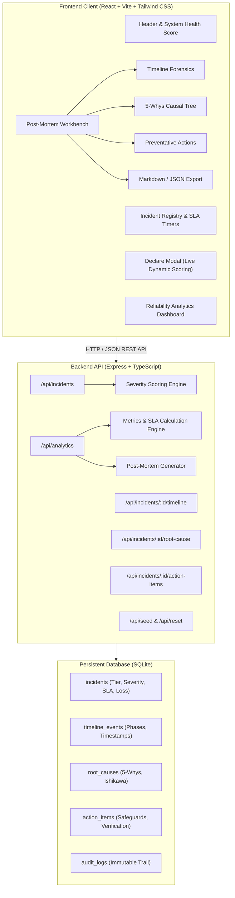
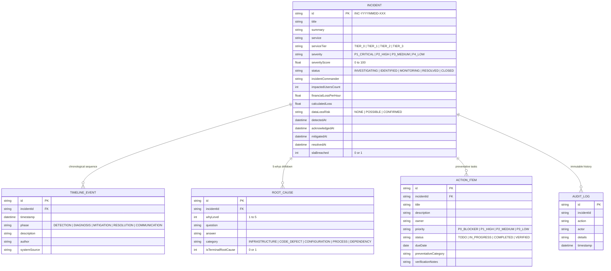

# ReliantOps — Site Reliability Engineering Incident Command, Root Cause Analysis & Post-Mortem Intelligence Platform

[](https://github.com/)
[](https://nodejs.org/)
[-sky)](https://sqlite.org/)
[](LICENSE)

> A production-grade Site Reliability Engineering (SRE) incident response command center and automated post-mortem platform. Built for modern DevOps and cloud infrastructure teams to triage critical outages, sequence forensic timelines, conduct 5-Whys root-cause drilldowns, enforce closed-loop preventative action items, calculate SLA breach financial exposure, and publish executive-ready post-mortems.

---

## 1. Problem Statement

When production outages strike microservice architectures, engineering teams encounter recurring organizational and operational bottlenecks:

1. **Chaotic Severity Triage**: Severity assignment is often subjective or emotionally charged during an outage. Teams lack dynamic scoring algorithms that weigh blast radius (impacted users), architectural service tier, transactional revenue burn, and data loss risk.
2. **Scattered Forensic Timelines**: Incident event logs, alerts, configuration rollbacks, and chat transcripts are fragmented across Slack, Datadog, PagerDuty, and cloud consoles, making chronological reconstruction error-prone.
3. **Superficial Root Cause Analysis**: Incident reviews frequently stop at surface-level symptoms (e.g., "server crashed") rather than drilling down into systemic architectural or governance flaws (the 5-Whys method & Ishikawa categorization).
4. **Neglected Preventative Actions**: Corrective action items are created in task trackers but lack verification workflows, causing the same incident failure mode to recur months later.
5. **Slow, Inconsistent Post-Mortem Reporting**: Incident commanders spend hours manually drafting executive reports, compiling SLA compliance statistics, and estimating financial downtime loss.

---

## 2. Target Users

- **Site Reliability Engineers (SREs)** & **DevOps Engineers**: Leading live incident triage, telemetry correlation, and SLA compliance monitoring.
- **Incident Commanders**: Orchestrating cross-functional responses, declaring severity, and assigning preventative safeguards.
- **Engineering Managers & Tech Leads**: Reviewing system reliability health scores, MTTR/MTTD trends, and recurring failure modes across services.
- **CTOs & Executive Stakeholders**: Reviewing SLA breach penalties, financial loss exposure, and system resilience investments.

---

## 3. Solution Overview

**ReliantOps** provides an end-to-end reliability platform with **5 core engineering workflows**:

```
[Outage Occurs]
       ↓
1. Dynamic Severity Triage (Evaluates Tier, Blast Radius, Financial Burn, Data Risk)
       ↓
2. Forensic Timeline Reconstruction (Sequences milestones: Detection → Diagnosis → Mitigation → Resolution)
       ↓
3. 5-Whys Root Cause Engine (Ishikawa Factor Tree & Terminal Root Cause derivation)
       ↓
4. Preventative Engineering Lifecycle (Priority, Owner, Category, Closed-Loop Verification)
       ↓
5. Automated Executive Post-Mortem & Analytics (Financial loss modeling, MTTR/MTTD, Markdown/PDF Export)
```

---

## 4. Key Workflows & Engineering Features

### Workflow 1: Dynamic Severity Scoring & SLA Matrix Engine
- Evaluates 4 dimensional inputs:
  - **Service Architecture Tier**: Tier 0 (Core Transactional, 35 pts), Tier 1 (Customer Facing, 25 pts), Tier 2 (Internal/Async, 15 pts), Tier 3 (Utility, 5 pts).
  - **User Blast Radius**: Scaled by impacted user population (<100 to >50,000 users, up to 25 pts).
  - **Data Integrity Risk**: `NONE` (0 pts), `POSSIBLE` (15 pts), `CONFIRMED` (25 pts).
  - **Financial Velocity**: Hourly revenue burn rate ($/hour, up to 15 pts).
- Outputs deterministic severity level (`P1_CRITICAL`, `P2_HIGH`, `P3_MEDIUM`, `P4_LOW`), 0–100 numerical severity score, active SLA countdown target, and transparent justification rationale.

### Workflow 2: Forensic Timeline Reconstruction & Interval Forensics
- Chronological event logger with phase categorization: `DETECTION`, `DIAGNOSIS`, `MITIGATION`, `RESOLUTION`, `COMMUNICATION`.
- Computes operational intervals:
  - **MTTA** (Mean Time to Acknowledge)
  - **MTTM** (Mean Time to Mitigate)
  - **MTTR** (Mean Time to Resolve)
  - **Total Outage Duration** vs. **Max SLA Window**
- Flags chronological anomalies and automatically updates status progression.

### Workflow 3: Interactive 5-Whys Root Cause Tree
- Step-by-step causal ladder (Level 1 through Level 5) drilling down from direct symptom to root vulnerability.
- Ishikawa category tagging: `INFRASTRUCTURE`, `CODE_DEFECT`, `CONFIGURATION`, `PROCESS`, `DEPENDENCY`.
- Designates verified terminal root causes to eliminate repeat failure modes.

### Workflow 4: Preventative Engineering Safeguard Lifecycle
- Assigns actionable engineering tasks with priority (`P0_BLOCKER`, `P1_HIGH`, `P2_MEDIUM`, `P3_LOW`), owners, and target completion dates.
- Preventative category classification: `ARCHITECTURAL_RESILIENCE`, `MONITORING_ALERTING`, `AUTOMATION`, `RUNBOOK_PROCESS`, `CHAOS_TESTING`.
- **Closed-Loop SRE Verification**: Requires post-implementation verification notes before marking items as verified.

### Workflow 5: Executive Post-Mortem Generation & System Analytics
- **Financial Loss Modeling**: Automatically computes total downtime cost based on outage duration and financial velocity.
- **One-Click Post-Mortem Export**: Instantly compiles and downloads publication-ready Markdown reports (`.md`) complete with timeline tables, 5-whys trees, and metrics.
- **Reliability Dashboard**: Live platform health score, SLA compliance percentage, active outage monitor, and service reliability matrix.
- **One-Click Demo Scenarios**: Pre-loads 3 realistic real-world production outages for instant evaluation and demonstration.

---

## 5. Technology Stack & Architectural Decisions

| Layer | Technology | Engineering Rationale |
| :--- | :--- | :--- |
| **Frontend Framework** | React 19 + TypeScript | Reactive component architecture for real-time calculation previews and interactive workbenches. |
| **Build Tool & Bundler** | Vite 8 + Tailwind CSS | Sub-second HMR during development, optimized production chunking (327ms builds), sleek dark-mode SRE UI. |
| **Icons & Styling** | Lucide React | High-clarity iconography for SRE operational states, phases, and severity levels. |
| **Backend Framework** | Node.js + Express + TypeScript | Lightweight, high-throughput REST API with structured error handling and routing. |
| **Database & Storage** | SQLite (`node:sqlite` Native) | Zero-dependency embedded SQL engine with ACID transactions, foreign keys, and WAL mode. No Docker or PostgreSQL installation needed to run or grade. |
| **Post-Mortem Engine** | Custom Markdown Compiler | Compiles structured relational entities into publication-ready Markdown and downloadable reports. |

---

## 6. System Architecture



---

## 7. Data Models & Entity Relationships



---

## 8. Quick Start & Local Setup

### Prerequisites
- **Node.js**: v20+ or v22+ (Node.js v24 is pre-tested)
- **npm**: v10+

### Installation & Run

1. **Clone the repository**:
   ```bash
   git clone <your-repository-url>
   cd Final_Project
   ```

2. **Install all dependencies (Client & Server)**:
   ```bash
   npm run setup
   ```

3. **Start the complete platform in Development Mode**:
   ```bash
   npm run dev
   ```
   - Frontend Client: `http://localhost:5173`
   - Backend API: `http://localhost:4000`

4. **Or Build and Run in Production Mode (Single Port)**:
   ```bash
   npm run build
   npm start
   ```
   - Entire application (UI + API) served on: `http://localhost:4000`

---

## 9. Environment Configuration

ReliantOps runs out-of-the-box with zero required environment variables. Optional configurations can be specified in a `.env` file in `server/`:

```env
PORT=4000
NODE_ENV=production
```


